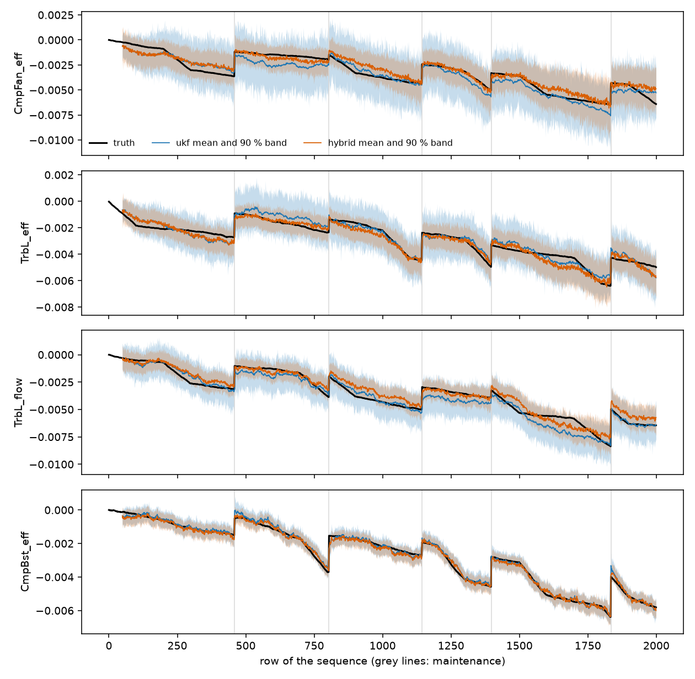

# engine-health-flow

Estimating the health of a turbofan engine from noisy sensors. The repo has four standard baselines, an unscented Kalman filter (UKF) on a learned model of the sensors, and a flow matching model that returns samples instead of one number. Code, tests and the result files of every run are here.

The task and the data come from the public Safran Tech / IRT SystemX benchmark (Leyli-Abadi et al., [arXiv 2604.08460](https://arxiv.org/abs/2604.08460)). I am not affiliated with Safran. All engines are simulated.

## Task and data

One sequence is one simulated engine, up to 2,000 flights long. At every flight there are 28 sensor readings (7 sensors in each of 4 flight phases) and 10 health indicators to recover: the efficiency and the flow modifier of five modules (booster, fan, high pressure compressor, high and low pressure turbine). There are 559 sequences and 1.1 million rows. Three of the 28 channels never change, so 25 are used. A maintenance event, flagged in the data, pushes the indicators back up; there are about five per sequence.

The data is a CC-BY-4.0 Zenodo record ([sandbox record 469530](https://sandbox.zenodo.org/records/469530), the paper says the link will move). `ehf download` fetches it and checks the md5.

## Protocol

- The sequences are split into 5 folds, and each fold gives about 70 / 10 / 20 % of them to train / validation / test. Fold k is the test set of run k.
- Every model is scored on the same rows: every fifth row that has at least 49 rows before it in its sequence (43,443 test rows on fold 0).
- RMSE, SMAPE and Pearson are computed on all indicators pooled. My SMAPE counts 0 / 0 as no error, the paper does not say what it does there.
- Models that give samples are also scored with the CRPS and with the coverage of their 90 % intervals.
- What is chosen is chosen on the validation sequences: the two noise scales of the UKF and the spread factors described below.
- The paper tunes every model with Optuna on the validation set. Here the baselines and the flows get a fixed number of training steps and no tuning.

## Results

Test sets of the five folds, mean ± standard deviation over the folds. RMSE is in units of 1e-3 of the health indicators. The CRPS and the coverage need samples, so only the UKF, the flow and the hybrid have them. The "rescaled" columns use the spread factors described under Models.

| model | RMSE x1e3 | SMAPE | Pearson | CRPS x1e3 | 90% cover | CRPS x1e3 rescaled | 90% cover rescaled |
|---|---|---|---|---|---|---|---|
| ridge | 1.36 ± 0.04 | 0.158 ± 0.001 | 0.979 ± 0.001 | - | - | - | - |
| boosting | 1.57 ± 0.04 | 0.169 ± 0.001 | 0.972 ± 0.001 | - | - | - | - |
| mlp | 1.52 ± 0.07 | 0.153 ± 0.002 | 0.974 ± 0.002 | - | - | - | - |
| gru | 1.09 ± 0.06 | 0.102 ± 0.002 | 0.987 ± 0.001 | - | - | - | - |
| ukf | 0.87 ± 0.04 | 0.098 ± 0.003 | 0.992 ± 0.000 | 0.420 ± 0.056 | 0.98 ± 0.01 | 0.344 ± 0.021 | 0.82 ± 0.02 |
| flow | 0.99 ± 0.05 | 0.100 ± 0.001 | 0.989 ± 0.001 | 0.375 ± 0.016 | 0.94 ± 0.01 | 0.363 ± 0.017 | 0.86 ± 0.01 |
| hybrid | 0.84 ± 0.04 | 0.091 ± 0.001 | 0.992 ± 0.000 | 0.331 ± 0.015 | 0.93 ± 0.01 | 0.318 ± 0.016 | 0.87 ± 0.01 |

The standard deviation over folds is large next to the gaps between the best models, so I also compare models fold by fold. The table gives the difference of the model on the left minus the one on the right, and in how many folds it is lower:

| pair | RMSE x1e3 | CRPS x1e3 | CRPS x1e3 rescaled |
|---|---|---|---|
| hybrid - ukf | -0.02 (lower in 5 of 5) | -0.089 (lower in 5 of 5) | -0.026 (lower in 5 of 5) |
| flow - gru | -0.10 (lower in 5 of 5) | - | - |
| flow - ukf | +0.12 (lower in 0 of 5) | -0.046 (lower in 5 of 5) | +0.018 (lower in 1 of 5) |
| hybrid - flow | -0.15 (lower in 5 of 5) | -0.044 (lower in 5 of 5) | -0.044 (lower in 5 of 5) |

RMSE x1e3 per health indicator, mean over the folds:

| model | CmpBst_eff | CmpBst_flow | CmpFan_eff | CmpFan_flow | CmpH_eff | CmpH_flow | TrbH_eff | TrbH_flow | TrbL_eff | TrbL_flow |
|---|---|---|---|---|---|---|---|---|---|---|
| ridge | 1.40 | 0.98 | 2.13 | 0.17 | 0.64 | 1.34 | 1.09 | 0.50 | 1.61 | 2.19 |
| boosting | 1.59 | 1.17 | 2.24 | 0.27 | 0.89 | 1.88 | 1.26 | 0.93 | 1.75 | 2.43 |
| mlp | 1.36 | 0.94 | 2.52 | 0.20 | 0.66 | 1.31 | 1.26 | 0.51 | 1.87 | 2.55 |
| gru | 0.52 | 0.38 | 2.30 | 0.18 | 0.35 | 0.58 | 0.77 | 0.26 | 1.63 | 1.52 |
| ukf | 0.39 | 0.28 | 1.88 | 0.09 | 0.21 | 0.41 | 0.57 | 0.17 | 1.32 | 1.17 |
| flow | 0.42 | 0.31 | 2.14 | 0.12 | 0.26 | 0.44 | 0.69 | 0.20 | 1.50 | 1.38 |
| hybrid | 0.39 | 0.28 | 1.84 | 0.12 | 0.25 | 0.42 | 0.55 | 0.19 | 1.30 | 1.11 |



One test sequence of fold 0 and four of the ten indicators, the first three being the hard ones. Black is the truth, blue and orange are the mean and the 90 % band of the UKF and of the hybrid after the spread rescaling, grey lines are maintenance events. The indicators start at 0 and drift down, and each maintenance lifts them back up. The figure comes from `scripts/plot_sequence.py`.

For orientation, Table 1 of the paper gives, as 5-fold averages of the RMSE x1e3, 1.53 for gradient boosting, 1.16 for the MLP, 0.95 for the GRU and 0.85 for its UKF. Mine are 1.57, 1.52, 1.09 and 0.87. The paper tunes every model with Optuna and its UKF uses the physics simulator as sensor model; mine does neither, so this is a sanity check and not a comparison.

## Models

- **ridge, boosting, MLP**: regressors on one row of sensors. **GRU**: reads a window of 50 rows.
- **surrogate**: a linear map plus an MLP from the 10 indicators to the 25 sensors. It stands in for the physics simulator, which is Linux only and not part of the data. On held-out sequences its residual is 0.056 standard deviations of a sensor (median over the sensors, fold 0), against 0.058 for the sensor noise estimated from second differences and 0.108 for a linear map alone (`scripts/surrogate_residual.py`).
- **ukf**: unscented Kalman filter in torch, run on all sequences of a batch at once. The state is the 10 indicators. Between two flights they follow a random walk with drift, except on a flagged maintenance row, where the step has the mean and covariance of the maintenance jumps in the training data. The two noise scales are picked on validation.
- **flow**: a GRU reads the last 50 rows and gives a context vector. An MLP velocity field moves noise to the 10 indicators along straight paths (conditional flow matching with optimal transport paths). Samples come from 8 Heun steps, 64 draws per row.
- **hybrid**: the same flow, but every row also carries the UKF mean and log standard deviation, so the window sees what a filter with the whole history made of the sensors.
- **spread factors**: one factor per indicator that scales the spread of the draws around their mean, fitted on validation to minimise the CRPS and then applied to the test rows.
- **phase dropout** (missing phase experiment): the flow is trained with whole flight phases of sensors randomly removed and flags that say which ones are there. The UKF just leaves the lost readings out of its update.

All models read the 25 standardised sensor channels. Only the UKF also reads the maintenance flag; the hybrid gets it through the filter.

## What the results say

- **The UKF beats every baseline and the flow on RMSE.** 0.87 against 1.09 for the GRU (20 % lower, and lower in all 5 folds) and 1.36 for the ridge. The comparison is not like for like: the UKF filters the whole sequence and knows where the maintenance events are, the others see one row or 50 rows. A control on fold 0 shows that the flag alone does not explain the gap: a GRU that also gets the flag as an input channel scores 1.17, the same as the GRU without it (1.16), against 0.89 for the UKF (`scripts/gru_with_maintenance_flag.py`, one seed).
- **The flow beats the GRU that reads the same window**: 9 % lower RMSE in all 5 folds, and it also gives a distribution. It stays 14 % behind the UKF, in all 5 folds.
- **The CRPS needs a fair width.** The raw 90 % intervals of the UKF cover 98 % of the truth, so they are too wide; those of the flow cover 94 %. On the raw CRPS the flow beats the UKF (0.375 against 0.420, in all 5 folds), but that mostly measures the width. With one spread factor per indicator fitted on validation, the UKF is ahead (0.344 against 0.363, the flow is better in 1 fold of 5). After the rescaling the 90 % intervals cover 82 % (UKF), 86 % (flow) and 87 % (hybrid): the width that minimises the CRPS is narrower than the nominal one, because the errors have heavier tails than a Gaussian.
- **The hybrid is the best model on every column of the table, by a small margin.** RMSE 0.84 against 0.87 for the UKF: lower in all 5 folds, but by only 0.006 to 0.050 per fold, and the standard deviation over folds is 0.04. The rescaled CRPS gain is larger, 0.318 against 0.344 (7.6 %, 5 of 5 folds). Reading the filter makes the flow much better (0.84 against 0.99 for the flow alone). The gain comes from the hard indicators below; the hybrid is a little worse than the UKF on a few easy ones (for example CmpFan_flow 0.12 against 0.09, CmpH_eff 0.25 against 0.21, TrbH_flow 0.19 against 0.17).
- **Three indicators carry the error.** CmpFan_eff, TrbL_eff and TrbL_flow make up about 89 % of the squared error of the UKF. The paper also finds them weakly observable.
- **Time since the last maintenance.** The table is RMSE x1e3, UKF / GRU, on the test sequences of fold 0 (`scripts/error_by_time_since_maintenance.py`). "Rows since" counts from the last maintenance event or from the start of the sequence.

| rows since | scored rows | 3 hard indicators | 7 others |
|---|---|---|---|
| 0 to 50 | 5,757 | 1.37 / 1.55 | 0.43 / 0.45 |
| 50 to 100 | 6,730 | 1.33 / 1.61 | 0.32 / 0.37 |
| 100 to 200 | 13,011 | 1.48 / 1.88 | 0.33 / 0.42 |
| 200 to 300 | 10,268 | 1.66 / 2.17 | 0.34 / 0.50 |
| 300 and more | 7,677 | 1.74 / 2.42 | 0.35 / 0.60 |

  On the seven easy indicators the UKF error is flat after the first 50 rows (0.32 to 0.35) while the GRU error grows from 0.37 to 0.60. On the three hard ones both models get worse as time passes since the last event, the UKF by 31 % (1.33 to 1.74) and the GRU by 50 % (1.61 to 2.42). The first 50 rows after an event are harder for the UKF too (0.43 on the easy indicators): it needs some rows to settle after a jump.

## Losing a flight phase

The UKF and a flow trained with phase dropout, on fold 0 with one seed. Each row takes away the 7 sensors of one flight phase at test time. The UKF skips them in its update. The flow was trained with phases removed at random and is told which ones are there. The spread factors are fitted on validation with every sensor present and used in all rows, which is why the CRPS columns are the rescaled ones.

| lost phase | RMSE x1e3 ukf | RMSE x1e3 flow | CRPS x1e3 rescaled ukf | CRPS x1e3 rescaled flow | 90% cover ukf | 90% cover flow | 90% cover rescaled ukf | 90% cover rescaled flow |
|---|---|---|---|---|---|---|---|---|
| none | 0.89 | 1.43 | 0.358 | 0.610 | 1.00 | 0.91 | 0.84 | 0.87 |
| Cruise | 1.15 | 1.66 | 0.443 | 0.735 | 1.00 | 0.90 | 0.84 | 0.83 |
| Takeoff | 1.16 | 1.45 | 0.451 | 0.625 | 1.00 | 0.90 | 0.84 | 0.86 |
| Climb1 | 1.20 | 1.44 | 0.461 | 0.621 | 1.00 | 0.90 | 0.82 | 0.87 |
| Climb2 | 1.06 | 1.46 | 0.433 | 0.630 | 1.00 | 0.90 | 0.82 | 0.86 |

- The UKF stays ahead in every condition, on RMSE and on the rescaled CRPS. Losing a phase costs it 19 to 35 % of its RMSE.
- The flow degrades much less: 1 to 2 % when Takeoff, Climb1 or Climb2 is lost, 16 % for Cruise. But it starts 35 % above the plain flow of the main table (1.43 against 1.06 on this fold), because training with phase dropout also costs accuracy when every sensor is there. The ranking never changes.
- After the rescaling the coverage of the 90 % intervals stays between 0.82 and 0.87 in every condition, for both models, so the spread follows the errors when readings are missing. Before the rescaling the flow covers 0.90 to 0.91 and the UKF 1.00, the same width problem as in the main table.
- This is one fold and one seed: a probe, not a result.

## Status and limits

Status: reproducible research code, not production tested. Simulated numbers only.

- The engines are simulated. Nothing here says anything about real flight data.
- The UKF here is not the paper's UKF. The paper's filter uses the OpenDeckSMR simulator as its sensor model, an identity transition and very small noise (Q = 1e-7, R = sensor noise / 10, from a shallow grid search). Mine uses a learned surrogate and a drift and jump model fitted on the training sequences. Its two noise scales are picked on validation and are far above what the training data measures: on fold 0 the filter takes a process noise 256 times the covariance of the steps and a measurement noise 3 times the residual of the surrogate. That is the corner of the grid that `fit_ukf` searches, but a wider grid (`scripts/ukf_noise_grid.py`) shows that the minimum is not at an edge: the validation RMSE rises again for a process scale of 1024 and for a measurement scale of 6, and along the valley where both scales grow together it stays between 0.896 and 0.902 (process 64 with measurement 2: 0.902, 256 with 3: 0.897, 256 with 4: 0.896). My guess is that the filter has to absorb the small errors of the surrogate and indicators that do not move like a plain random walk. A model with a constant rate between two maintenance events did not help, and I did not look further.
- The hybrid is trained on filter outputs computed on the training sequences, which the surrogate has seen. On fold 0 the UKF RMSE is 0.82 on the training sequences, 0.90 on validation and 0.89 on test, so the filter inputs are about 8 % better in training than on new sequences. The flow may trust the filter a little too much.
- One seed per fold. The spread over folds is the only error bar.
- The baselines use fixed budgets and no tuning. On fold 0 an MLP with 20,000 steps instead of 4,000 scores 1.82 on test instead of 1.59, and a GRU with 12,000 steps instead of 3,000 scores 1.29 instead of 1.16 (`scripts/training_budget.py`). Longer training overfits, so the gap to the tuned MLP and GRU of the paper is not a matter of step count; regularisation and early stopping are what I would try next.
- The UKF filters a sequence from its first row, the windowed models see 50 rows, and the error by time since the last maintenance suggests that this matters.
- The UKF raw intervals are far too wide because the noise scales picked for the RMSE are large. The spread factors fix the width, not the shape.
- The CRPS-optimal width gives intervals that cover less than 90 % of the truth: the errors have heavier tails than a Gaussian.
- The fit times stored in the result files come from the wall clock, and one fold includes a night with the laptop asleep. I left them out of the tables. Later runs use a monotonic clock.
- The result files of the five folds were written at commit 0f2744c and the missing phase file at commit 5e4d923. In between only the tables, the scoring of the missing phase experiment and a timing line changed, not the models.
- Not done: other noise levels, operating changes, anomaly detection, any real data. The missing phase experiment runs on one fold only.

## How this was built

I chose the problem, the protocol and the models, and read the results. Almost all of the code and the tests were written with an AI coding assistant (GitHub Copilot in VS Code), step by step in small commits. The tables come from the files in `results/`, which store the hardware, the seed, the date and the commit of the run. The other numbers quoted above come from the scripts in `scripts/`; what they printed is saved in `results/analysis/`.

## Reproduce

```
uv sync
uv run ehf download
uv run ehf run --fold 0          # about 15 minutes on a laptop CPU, writes results/fold0.json
uv run ehf table results/fold*.json
uv run ehf missing --fold 0      # the missing flight phase experiment
uv run pytest
```

`ehf run --models ridge,ukf` runs a subset. Everything runs on the CPU. The scripts in `scripts/` make the figure and the extra analyses quoted above.

## Layout

```
src/engine_health_flow/
  data.py        csv layout, download with md5 check, Dataset
  splits.py      folds          scaling.py   standardisation
  windows.py     windows of rows
  baselines.py   ridge, boosting      neural.py   MLP, GRU
  training.py    small training loop, random batches
  surrogate.py   learned sensor model
  ukf.py         unscented Kalman filter
  flow.py        flow matching posterior      hybrid.py   flow that reads the filter
  missing.py     lost flight phase experiment
  metrics.py     RMSE, SMAPE, Pearson, CRPS, intervals, spread factors
  experiment.py  one fold, all models          report.py   markdown tables
  cli.py         ehf download | info | run | table | missing
scripts/         plot_sequence.py, error_by_time_since_maintenance.py, training_budget.py,
                 surrogate_residual.py, gru_with_maintenance_flag.py, ukf_noise_grid.py
results/         json files written by ehf run and ehf missing
                 analysis/ holds what the scripts printed (fold 0)
tests/
```

## Data and licence

Code: Apache-2.0. Data: CC-BY-4.0, cite the paper above and the Zenodo record. The simulator (OpenDeckSMR, Safran Tech and Aristotle University of Thessaloniki) is not used.
